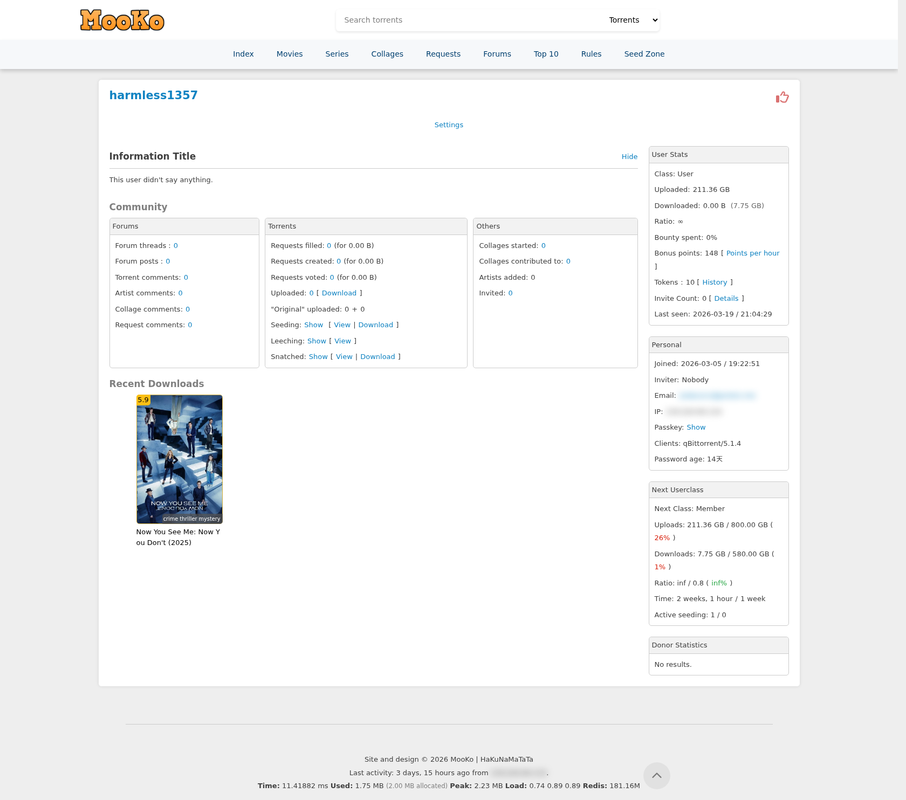
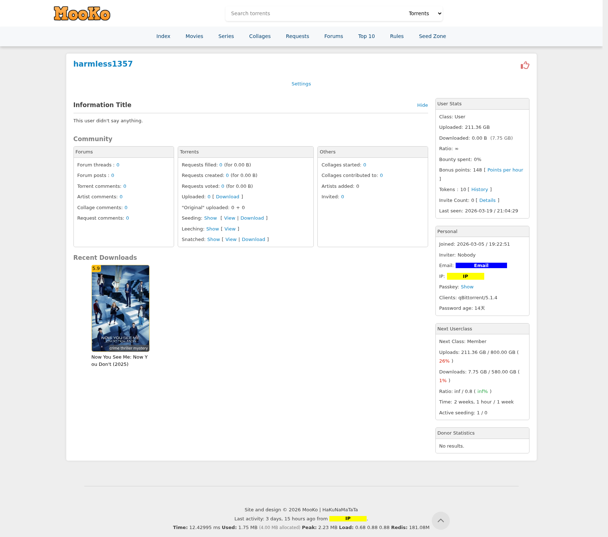

# Tracker Profiles

A self-hosted web app that logs in to your private torrent trackers and saves a redacted, full-page screenshot of each profile page.


- [Overview](#overview)
- [Features](#features)
    - [Redaction Examples](#redaction-examples)
- [Quick Start](#quick-start)
- [Trackers](#trackers)
    - [Headless](#headless)
    - [Manual Interaction](#manual-interaction)
- [Using The Web UI](#using-the-web-ui)
    - [Main Tab](#main-tab)
    - [Trackers Tab](#trackers-tab)
    - [Settings Tab](#settings-tab)
    - [Manual Trackers](#manual-trackers)
    - [Importing Trackers](#importing-trackers)
    - [Backing Up And Restoring](#backing-up-and-restoring)
    - [Stored Data And Security](#stored-data-and-security)
- [Running The Application](#running-the-application)
    - [Running With Docker Compose](#running-with-docker-compose)
    - [Configuration Options](#configuration-options)
        - [Run Options](#run-options)
        - [Startup-Only Options](#startup-only-options)
        - [JVM Options](#jvm-options)
- [Versioning](#versioning)
- [AI Usage](#ai-usage)
    - [AI Agents](#ai-agents)
    - [Established Patterns](#established-patterns)
    - [JavaScript Redaction](#javascript-redaction)
    - [UI](#ui)
- [Contributing](#contributing)
    - [Requirements](#requirements)
    - [Install Git Hooks](#install-git-hooks)
    - [Building And Developing In Docker](#building-and-developing-in-docker)
    - [Implementing Support For New Trackers](#implementing-support-for-new-trackers)
    - [Debugging Application](#debugging-application)
    - [Performance Analysis](#performance-analysis)
    - [Cloudflare Verification](#cloudflare-verification)

## Overview

Tracker Profiles logs in to private torrent websites and takes a screenshot of your profile page on each one. This can be used to showcase your
stats on a tracker as part of an application to another site. It can also be used as a historical record of your stats on a tracker in case it goes
down or becomes otherwise unavailable.

The application is a web app, run as a single Docker container, and used entirely from its [web UI](#using-the-web-ui): there is nothing to
install or run on the host besides Docker.

## Features

- **Profile screenshots**: opens each enabled tracker, logs in, navigates to your profile page, redacts your sensitive information, takes a
  full-page screenshot, and logs out, with several trackers executed in parallel
- **Redaction** of your email address, IP address (including ISP) and passkeys (for torrents or IRC), with a solid box, a Gaussian blur, or no
  redaction (several types can be selected, with a screenshot for each)
- **Manual trackers**: a tracker that needs a captcha or 2FA to log in shows its browser live in the web UI, where you complete the step (nothing
  is shown on the host, so it also works on a headless server)
- **Cloudflare verification** checks are passed automatically, without any user input
- **Screenshot history**: the latest screenshots and result of every tracker are kept across restarts, can be viewed in the web UI, and downloaded
  individually or as a zip file. Only the trackers that failed can be executed again

### Redaction Examples

Below are examples of the different types of redaction from the [MooKo](https://mooko.org/) tracker (no longer active).

<details>
<summary>Example Screenshots</summary>
<table>
<tr>
<td valign="top">

#### None


</td>
<td valign="top">

#### Blur



</td>
<td valign="top">

#### Box



</td>
</tr>
</table>
</details>

## Quick Start

Download the [example compose file](./docs/docker-compose.example.yml) into an empty directory, set a new secret to encrypt the stored
passwords, and start the container:

```bash
curl -fsSL -o docker-compose.yml https://raw.githubusercontent.com/zodac/tracker-profiles/master/docs/docker-compose.example.yml
sed -i "s|change-me-strong-secret|$(openssl rand -base64 32)|" docker-compose.yml
mkdir -p /tmp/screenshots
docker compose up -d
```

Then open the web UI at [http://localhost:8080](http://localhost:8080):

1. Enter your username and password for one or more [supported trackers](#trackers) on the **Trackers** tab, and switch each one on to enable
   it (or [import them from a CSV file](#importing-trackers), which enables them)
2. Press **Start** on the **Main** tab, and follow each tracker as it runs. A [manual tracker](#manual-interaction) asks for your input on the
   **Main** tab when it needs it
3. Open or download the screenshots from each tracker's row

See [Using The Web UI](#using-the-web-ui) for more details, and [Running With Docker Compose](#running-with-docker-compose) for the options of the
compose file.

## Trackers

There are currently **147** supported trackers listed below. The available trackers come in the following types:

- Headless: Run in the background, with no input needed from you
- Manual: Need your input to log in (a Captcha, 2FA, etc.), which you give in the tracker's browser, shown in the web UI

The implementation for these trackers can be found in the [handler](./tracker-profiles-screenshots/src/main/java/net/zodac/tracker/handler) package.

### Headless

The following trackers do not require a UI, and can be run in the background:

<table>
<tr>
<td valign="top">

| Tracker Name (A–E)                                |
|---------------------------------------------------|
| [720pier](https://720pier.ru/)                    |
| [ABTorrents](https://usefultrash.net/)            |
| [AcrossTheTasman](https://acrossthetasman.com/)   |
| [Aidoru!Online](https://aidoru-online.me/)        |
| [Aither](https://aither.cc/)                      |
| [Alexandria](https://alxdria.org/)                |
| [AlphaRatio](https://alpharatio.cc/)              |
| [AnimeBytes](https://animebytes.tv/)              |
| [AnimeZ](https://animez.to/)                      |
| [ArabicSource](https://arabicsource.net/)         |
| [ArabP2P](https://www.arabp2p.net/)               |
| [AsianCinema](https://eiga.moi/)                  |
| [AussieRul.es](https://aussierul.es/)             |
| [BackUps](https://back-ups.me/)                   |
| [BakaBT](https://bakabt.me/)                      |
| [bitGAMER](https://bitgamer.ch/)                  |
| [BitPorn](https://bitporn.eu/)                    |
| [BlueTorrents](https://bluetorrents.com/)         |
| [Blutopia](https://blutopia.cc/)                  |
| [BootyTape](https://ssl.bootytape.com/)           |
| [BroadcasThe.Net](https://broadcasthe.net/)       |
| [BrokenStones](https://brokenstones.is/)          |
| [BwTorrents](https://bwtorrents.tv/)              |
| [C411](https://c411.org/)                         |
| [CanalStreet](https://canal-street.org/)          |
| [CapybaraBR](https://capybarabr.com/)             |
| [Cathode-Ray.Tube](https://www.cathode-ray.tube/) |
| [Concertos](https://concertos.live/)              |
| [CZTeam](https://czteam.me/)                      |
| [D3Si.NET](https://d3si.net/)                     |
| [DarkPeers](https://darkpeers.org/)               |
| [DesiTorrents](https://desitorrents.tv/)          |
| [DICMusic](https://dicmusic.com/)                 |
| [DimeADozen](http://www.dimeadozen.org/)          |
| [DocsPedia](https://docspedia.world/)             |
| [Empornium](https://www.empornium.sx/)            |
| [eMuwarez](https://emuwarez.com/)                 |
| [ExtremeBits](https://extremebits.net/)           |

</td>
<td valign="top">

| Tracker Name (F–J)                              |
|-------------------------------------------------|
| [F1Carreras](https://f1carreras.xyz/)           |
| [Fappaizuri](https://fappaizuri.me/)            |
| [FileList](https://filelist.io/)                |
| [FunFile](https://www.funfile.org/)             |
| [FunZone](https://myfunzone.org/)               |
| [GreatPosterWall](https://greatposterwall.com/) |
| [HappyFappy](https://www.happyfappy.net/)       |
| [HDUnited](https://hd-united.vn/)               |
| [HDZero](https://hdzero.org/)                   |
| [Hellenic-HD](https://hellenic-hd.cc/)          |
| [Immortal-S](https://immortal-s.me/)            |
| [ImmortalSeed](https://immortalseed.me/)        |
| [InfinityHD](https://infinityhd.net/)           |
| [IPTorrents](https://iptorrents.com/)           |
| [ItaTorrents](https://itatorrents.xyz/)         |
| [JPopsuki](https://jpopsuki.eu/)                |

</td>
<td valign="top">

| Tracker Name (K–O)                             |
|------------------------------------------------|
| [Kufirc](https://kufirc.com/)                  |
| [LastFiles](https://last-torrents.org/)        |
| [Lat-Team](https://lat-team.com/)              |
| [LDU](https://theldu.to/)                      |
| [Libble](https://libble.me/)                   |
| [Linuxtracker](https://linuxtracker.org/)      |
| [Luminarr](https://luminarr.me/)               |
| [MalayaBits](https://malayabits.cc/)           |
| [Metal-Tracker](https://en.metal-tracker.com/) |
| [MidnightScene](https://midnightscene.cc/)     |
| [Milkie](https://milkie.cc/)                   |
| [Milnueve](https://milnueve.cc/)               |
| [Nebulance](https://nebulance.io/)             |
| [Nexum-Core](https://nexum-core.com/)          |
| [NordicBytes](https://nordicbytes.org/)        |
| [NordicQuality](https://nordicq.org/)          |
| [OldToons.World](https://oldtoons.world/)      |
| [OnlyEncodes](https://onlyencodes.cc/)         |
| [Orpheus](https://orpheus.network/)            |

</td>
<td valign="top">

| Tracker Name (P–T)                                   |
|------------------------------------------------------|
| [P2PBG](https://www.p2pbg.com/)                      |
| [PixelCove](https://www.pixelcove.me/)               |
| [PixelHD](https://pixelhd.me/)                       |
| [Podzemlje](https://podzemlje.net/)                  |
| [PolishTorrent](https://polishtorrent.top/)          |
| [Portugas](https://portugas.org/)                    |
| [PussyTorrents](https://pussytorrents.org/)          |
| [Racing4Everyone](https://racing4everyone.eu/)       |
| [Rastastugan](https://rastastugan.org/)              |
| [Redacted](https://redacted.sh/)                     |
| [ReelFlix](https://reelflix.cc/)                     |
| [RetroMoviesClub](https://retro-movies.club/)        |
| [RocketHD](https://rocket-hd.cc/)                    |
| [RUTracker](https://rutracker.org/forum/tracker.php) |
| [SceneHD](https://scenehd.org/)                      |
| [SceneTime](https://www.scenetime.com/)              |
| [SecretCinema](https://secret-cinema.pw/)            |
| [SeedCore](https://seedcore.net/)                    |
| [SeedPool](https://seedpool.org/)                    |
| [SexTorrent](https://sextorrent.myds.me/)            |
| [Shadowbit](https://shadowbit.cc/)                   |
| [Shazbat](https://www.shazbat.tube/)                 |
| [Speed.CD](https://speed.cd/)                        |
| [SpeedApp](https://speedapp.io/)                     |
| [SportsCult](https://sportscult.org/)                |
| [T3nnis](https://t3nnis.tv/)                         |
| [Tasmanit.es](https://tasmanit.es/)                  |
| [TeamOS](https://teamos.xyz/)                        |
| [TheMixingBowl](https://themixingbowl.org/)          |
| [TorrentDay](https://www.torrentday.com/)            |
| [Torrenteros](https://torrenteros.org/)              |
| [Torrenting](https://torrenting.com/)                |
| [TorrentLeech](https://www.torrentleech.org/)        |
| [Tr4ker](https://tr4ker.net/)                        |
| [TVChaosUK](https://tvchaosuk.com/)                  |

</td>
<td valign="top">

| Tracker Name (U–Z)                              |
|-------------------------------------------------|
| [Ultrabits](https://ultrabits.org/)             |
| [Unwalled](https://unwalled.cc/)                |
| [UploadCX](https://upload.cx/)                  |
| [VietMediaF](https://tracker.vietmediaf.store/) |
| [XSpeeds](https://www.xspeeds.eu/)              |
| [XWT-Classics](https://xwt-classics.net/)       |
| [YggReborn](https://www.yggreborn.org/)         |
| [YUSCENE](https://yu-scene.net/)                |
| [Zappateers](https://zappateers.com/)           |

</td>
</tr>
</table>

### Manual Interaction

If any of the following trackers are enabled, they run in a browser with a UI, in which you complete the step below. The browser runs inside the
container and is shown in the web UI, which asks you when to complete each step, so nothing needs to be set up on the host (see
[Manual Trackers](#manual-trackers)).

<table>
<tr>
<td valign="top">

| Tracker Name                                        | Reason                            |
|-----------------------------------------------------|-----------------------------------|
| [52PT](https://52pt.site/)                          | Captcha                           |
| [Anthelion](https://anthelion.me/)                  | 2FA                               |
| [AsianDVDClub](https://asiandvdclub.org/)           | Question on login                 |
| [AvistaZ](https://avistaz.to/)                      | Captcha                           |
| [Baozi](https://p.t-baozi.cc/)                      | Captcha                           |
| [BeyondHD](https://beyond-hd.me/)                   | Captcha                           |
| [BTArg](https://www.btarg.com.ar/tracker/)          | Needs to be explicitly translated |
| [CGPeers](https://cgpeers.to/)                      | 2FA                               |
| [CinemaZ](https://cinemaz.to/)                      | Captcha                           |
| [DigitalCore.Club](https://digitalcore.club/)       | Captcha                           |
| [ExoticaZ](https://exoticaz.to/)                    | Captcha                           |
| [GazelleGames](https://gazellegames.net/)           | Question on login                 |
| [Hawke-Uno](https://hawke.uno/)                     | 2FA                               |
| [HDBits](https://hdbits.org/)                       | 2FA & question on login           |
| [Leech24](https://leech24.net/)                     | Captcha                           |
| [LetSeed](https://letseed.org/)                     | Captcha                           |
| [LP-Bits](https://lp-bits.com/)                     | Captcha                           |
| [LST](https://lst.gg/)                              | Question on login                 |
| [PassThePopcorn](https://passthepopcorn.me/)        | Question on login                 |
| [PornoLab](https://pornolab.net/forum/tracker.php)  | Needs to be explicitly translated |
| [PrivateHD](https://privatehd.to/)                  | Captcha                           |
| [SkyeySnow](https://skyeysnow.com/)                 | Needs to be explicitly translated |
| [SocietyGlitch](https://stalker.societyglitch.com/) | Captcha                           |
| [TheEmpire](https://theempire.click/)               | Captcha                           |
| [TheGeeks](https://thegeeks.click/)                 | Captcha                           |
| [TheKitchen](https://thekitchen.click/)             | Captcha                           |
| [TheOccult](https://theoccult.click/)               | Captcha                           |
| [ThePlace](https://theplace.click/)                 | Captcha                           |
| [TheShow](https://theshow.click/)                   | Captcha                           |
| [TheVault](https://thevault.click/)                 | Captcha                           |

</td>
</tr>
</table>

### Unsupported

The following trackers are explicitly not supported, either due to limitations with accessing them, or due to their terms and conditions forbidding
this type of automated access.

<table>
<tr>
<td valign="top">

| Tracker Name                                  | Reason                                    |
|-----------------------------------------------|-------------------------------------------|
| [MyAnonaMouse](https://www.myanonamouse.net/) | Non-API access is not approved (Rule 1.7) |

</td>
</tr>
</table>

## Using The Web UI

Everything is done in the web UI, served on port `8080` (configurable with `WEB_UI_PORT`): open [http://localhost:8080](http://localhost:8080) once
the [container is running](#running-with-docker-compose). It has three tabs: [Main](#main-tab) to run an execution, [Trackers](#trackers-tab)
to manage your trackers and their screenshots, and [Settings](#settings-tab).

Changes are saved automatically (text fields once you stop typing), with a pop-up confirming each save. The UI follows your operating system's
light/dark mode, which can be overridden with the button in the header (the choice is remembered by your browser).

> **Note:** The screenshots of the web UI in this README use made-up credentials and results.

### Main Tab

Start an execution, and follow the progress of each tracker as it runs.


- **Start** executes every enabled tracker. If an execution has ended with failed trackers, **Failures only** executes just those trackers again
- Every tracker is grouped as in progress, waiting, failed or succeeded
- Each tracker shows which step it is on, and its latest message/failure
- Each tracker's 'in progress' screen can also be expanded to show the live browser (in read-only mode)
- If a tracker requires a manual input, the browser will appear and request you to perform the input. See [manual tracker](#manual-interaction).
- If a tracker has succeeded 3 times, an estimated time will appear based on previous runs
- Each screenshot can be downloaded after execution

### Trackers Tab

Enter the credentials of each tracker, enable the trackers to execute, and download their latest screenshots.


- Every supported tracker is listed, grouped as enabled or disabled, with trackers that have no username or password listed as unset
- Each tracker's last result is saved, so you can download screenshots from the last run
- **Import CSV** and **Export CSV** allow you to add or save the credentials of multiple trackers at once
  (see [Importing Trackers](#importing-trackers))
- **Download** allows you to bulk download the latest screenshots of every tracker:
    - **All**
    - **Successful** (the profile screenshots of each tracker's latest success)
    - **Blur redaction**/ **Box redaction**/ **No redaction**
    - **Errors** (the failure screenshot of each tracker whose latest execution failed)
- **Enable failed only** enables every tracker whose most recent execution failed and disables every tracker whose most recent execution succeeded
- A tracker that is no longer supported (removed from the application) is listed as legacy. It is not removed automatically, so it can be kept as a
  history

### Settings Tab

Change the run options, and back up or restore the application.


- Every [configuration option](#configuration-options) is shown with its value
- A value changed here from the one set by its environment variable (or its default, if not set) is marked with a bar,
- The **Backup** section downloads or restores a [backup](#backing-up-and-restoring) of the trackers, settings and screenshots

### Manual Trackers

When a [manual tracker](#manual-interaction) needs you to solve a captcha, enter a 2FA code or similar, a prompt appears on the **Main** tab, below
**Screenshot trackers** (and the tab title changes), showing the tracker's browser live. All prompts are in one **Waiting for your input** section,
which can be collapsed to put them aside. Clicking in a browser selects it (marked with a blue ring), after which your clicks, scrolling and
typing are sent to it until you click elsewhere (until then, scrolling over it scrolls this page). `Ctrl`+`V` pastes text from your clipboard (such as
a 2FA code). Complete the step, then select **Continue**; the execution also continues by itself if the page in the browser changes. **Reload page**
reloads the page in the browser and keeps waiting, such as to get a new captcha before (or after) one expires. **Skip tracker**
fails the current attempt for that tracker. The prompt waits until you respond (or the execution is cancelled). Several prompts can be shown at once,
each with its own
browser, and answered in any order while the headless trackers continue.

### Importing Trackers

Credentials for many trackers can be added at once with **Import CSV** on the **Trackers** tab. The format is `trackerName,username,password`. You can
export at any time to get a template for the CSV which you can update with your login information for each tracker. Each imported tracker is enabled,
and replaces any credentials already saved for it. Trackers in the file that are not supported are ignored.

**Export CSV** downloads `trackers.csv` with every supported tracker that has a username and password (enabled or disabled), in the same format, so
it can be imported again (for example, into a new container). If no tracker has been set yet, the file only has the header row, and can be used as a
template for the import.

> **Note:** The exported file contains your passwords in plain text, so keep it somewhere safe and delete it once it is no longer needed.

### Backing Up And Restoring

**Download backup** in the **Backup** section of the **Settings** tab downloads a zip file (`tracker-profiles_backup_v<version>_<date>.zip`)
with the settings saved in the web UI, and the last run, latest screenshots and estimated duration of each tracker. Its menu has two options:

- **Tracker credentials**: the credentials of every supported tracker with a username and password, as a `trackers.csv` file in the format of
  [Export CSV](#importing-trackers) (and whether each tracker is enabled)
- **Screenshots**: the latest screenshots of every tracker, as downloaded with **Download** > **All** on the **Trackers** tab

**Restore backup** (select it twice to confirm, then choose the file) restores everything in a backup, such as to move the application to another
machine: the credentials and screenshots too, if the backup includes them.

- A restore is merged with what is already stored: the settings, trackers and screenshots in the backup replace those already stored for the same
  setting or tracker, and anything else is kept
- The screenshots are restored into the current screenshot folder (`OUTPUT_DIRECTORY_PARENT_PATH`), in the same dated folders as when they were
  backed up. A screenshot that was not included is only shown if its file is still found where it was taken
- The `SECRET_KEY` of the new machine does not need to be the same
- Settings that no longer exist, or can only be set as environment variables, are not restored, nor are trackers that are no longer supported
- A backup cannot be restored while an execution is in progress

> **Note:** A backup with the tracker credentials contains your passwords in plain text, so keep it somewhere safe.

### Stored Data And Security

Tracker credentials, settings saved in the web UI, the result of each tracker's most recent execution and the location of the screenshots of its
latest successful execution are stored in a SQLite database (`DATABASE_PATH`), in the `/app/data` volume of the container. This is separate from the
screenshots, so it can be mounted, backed up or cleared on
its own. The [example compose file](./docs/docker-compose.example.yml) uses the named volume `tracker-profiles-data`:

- The data is kept when the container is recreated (`docker compose down` and `docker compose up`), as the named volume is reused
- To start again with no trackers or saved settings, remove the volume as well: `docker compose down --volumes` (or
  `docker volume rm tracker-profiles-data`)
- To keep the database on the host instead, bind-mount a directory in place of the named volume: `/tmp/tracker-profiles-data:/app/data` (it must be
  writable by the container user, UID `1000` by default)

If no volume is mounted, Docker creates an anonymous volume, which is not reused when a new container is created.

Settings saved in the web UI take precedence over environment variables (including after a restart). See
[Configuration Options](#configuration-options) for when a change to each option takes effect, and which can only be set as environment variables.

Tracker passwords are encrypted in the database (AES-256-GCM), with a key derived from the `SECRET_KEY` environment variable, which must be set to
at least 16 characters (for example, the output of `openssl rand -base64 32`). Keep the same secret for as long as the database is used: if it
changes, the stored passwords cannot be decrypted and the application does not start. Passwords saved by an earlier version in plain text are
encrypted when the application starts.

> **Note:** The web UI has no authentication. Do not expose the port outside your local network. Saved passwords are never sent back to the
> browser.

## Running The Application

### Running With Docker Compose

The application is run with Docker Compose. Download [docker-compose.example.yml](./docs/docker-compose.example.yml) as `docker-compose.yml` into an
empty directory, and update it:

- Set `SECRET_KEY`to a new secret
- Update the [configuration options](#configuration-options) as needed
- Optionally create and mount a screenshot directory (`/tmp/screenshots` by default), which must be writable by the container user (UID `1000`)

Then start the application with `docker compose up -d`. The web UI is available at [http://localhost:8080](http://localhost:8080).

### Configuration Options

All options are set with environment variables on the docker image. They fall into two groups:

- [Run Options](#run-options) can also be changed on the [Settings tab](#settings-tab) of the web UI (under **Run**)
- [Startup-Only Options](#startup-only-options) can only be set as environment variables, and need the container to be restarted to change

#### Run Options

These options apply from the next execution.

| Environment Variable            | Description                                                                                                                                                                                                                                     | Default Value |
|---------------------------------|-------------------------------------------------------------------------------------------------------------------------------------------------------------------------------------------------------------------------------------------------|---------------|
| *LOG_LEVEL*                     | The logging level for application output [ALL, TRACE, DEBUG, INFO, WARN, ERROR, FATAL, OFF](https://logging.apache.org/log4j/2.x/manual/customloglevels.html)                                                                                   | INFO          |
| *REDACTION_TYPE*                | Comma-separated list of redaction types to apply (if more than one is selected then multiple screenshots will be taken) [BLUR, BOX, NONE](./tracker-profiles-screenshots/src/main/java/net/zodac/tracker/framework/redactor/RedactionType.java) | BOX           |
| *EXECUTION_ORDER*               | The order in which trackers are executed: by name, or headless or manual trackers first (each by name) [ALPHABETICAL, HEADLESS_FIRST, MANUAL_FIRST]                                                                                             | ALPHABETICAL  |
| *NUMBER_OF_PARALLEL_THREADS*    | The number of trackers to execute at the same time [min: 1, max: 32]                                                                                                                                                                            | 5             |
| *NUMBER_OF_SCREENSHOT_ATTEMPTS* | The number of times to attempt to screenshot a tracker before marking it as a fail [min: 1, max: 5]                                                                                                                                             | 1             |
| *ENABLE_TRANSLATION_TO_ENGLISH* | Whether to translate non-English trackers to English                                                                                                                                                                                            | true          |

#### Startup-Only Options

These options are read once when the container starts. The application options are shown on the **Settings** tab of the web UI for reference (greyed
out, except `SECRET_KEY`, which is never shown), but cannot be changed there. `JAVA_OPTS` and `JAVA_ADDITIONAL_OPTS` configure the container
itself, so are not shown in the web UI.

| Environment Variable           | Description                                                                                                                                                                                                  | Default Value                 |
|--------------------------------|--------------------------------------------------------------------------------------------------------------------------------------------------------------------------------------------------------------|-------------------------------|
| *DATABASE_PATH*                | The path to the SQLite database storing tracker credentials, settings saved in the [web UI](#using-the-web-ui) and tracker results (inside the `/app/data` docker volume)                                    | /app/data/tracker-profiles.db |
| *JAVA_ADDITIONAL_OPTS*         | Additional JVM options to be appended to [start.sh](./docker/scripts/start.sh)                                                                                                                               |                               |
| *JAVA_OPTS*                    | Replaces all default JVM options entirely; if unset or empty, the built-in defaults are used (see [JVM Options](#jvm-options))                                                                               |                               |
| *OUTPUT_DIRECTORY_NAME_FORMAT* | The date format used to name the output directory created for the screenshots (see [Patterns for Formatting and Parsing](https://docs.oracle.com/javase/8/docs/api/java/time/format/DateTimeFormatter.html)) | yyyy-MM-dd                    |
| *OUTPUT_DIRECTORY_PARENT_PATH* | The location in which the dated output directory for the screenshots is created (the `/app/screenshots` docker volume, see [Running With Docker Compose](#running-with-docker-compose))                      | /app/screenshots              |
| *SECRET_KEY*                   | **Required.** The secret used to encrypt the tracker passwords stored in the database, at least 16 characters (never shown in the web UI)                                                                    |                               |
| *TIMEZONE*                     | The local timezone, used for the date in the names of the output directory and of downloaded screenshots                                                                                                     | UTC                           |
| *WEB_UI_PORT*                  | The port on which the [web UI](#using-the-web-ui) is served [min: 1, max: 65535]                                                                                                                             | 8080                          |

#### JVM Options

The following options are passed to the Java process by default:

```text
-Xms128m -Xmx512m
-XX:+UnlockExperimentalVMOptions -XX:+UseCompactObjectHeaders
-XX:+UseG1GC -XX:ParallelGCThreads=4 -XX:ConcGCThreads=2 -XX:MaxGCPauseMillis=200
-XX:SharedArchiveFile=/app/app.jsa -Xshare:auto
-Djava.util.logging.config.file=/app/logging.properties
```

Set `JAVA_OPTS` to replace all defaults entirely (e.g., to swap the GC algorithm or remove experimental flags). Set `JAVA_ADDITIONAL_OPTS` to append
extra flags on top of whichever options are active, which can be useful for enabling JFR recording, GC logging, or similar diagnostics.

## Versioning

This project follows [Semantic Versioning](https://semver.org/) (`MAJOR.MINOR.PATCH`):

- **MAJOR**: incompatible changes to the public API (e.g. removed or renamed configuration options, changed CSV format)
- **MINOR**: backwards-compatible new functionality added to the public API (e.g. new configuration options or trackers)
- **PATCH**: backwards-compatible bug fixes or code changes

Changes to the [trackers_example.csv](./trackers_example.csv) file are considered `MINOR` (new trackers) or `MAJOR` (updates to the tracker
name, or removal of support).

However, removing a tracker due to the site no longer being available is **not** considered a `MAJOR` change. Trackers are external to the
application and not part of its public API, as their availability depends on third-party sites that can change or disappear at any time. Tracker
removals will be released as `PATCH` versions.

## AI Usage

### AI Agents

[Claude Code](https://claude.com/claude-code) employs a multi-agent pipeline to implement each new tracker handler:

| Agent                    | Responsibility                                                                                                                                                             |
|--------------------------|----------------------------------------------------------------------------------------------------------------------------------------------------------------------------|
| **Orchestrator**         | Coordinates the full workflow, delegating to specialised sub-agents in sequence                                                                                            |
| **Login Agent**          | Inspects the tracker's login page to determine the correct selectors for the username field, password field, login button, and post-login confirmation element             |
| **Profile Agent**        | Navigates the user's profile page to identify the navigation selector that reaches it, the content selector that confirms it has loaded, and the logout button selector    |
| **Page Structure Agent** | Invoked when the profile agent flags structural elements and  detects cookie/consent banners, fixed headers, and fixed sidebars that must be handled before screenshotting |
| **Redactor Agent**       | Reviews the profile page for sensitive fields and determines the appropriate redaction selectors                                                                           |

### Established Patterns

I use AI agents to perform the "first-pass" implementation for a new tracker site. The AI will investigate and evaluate the generate structure of the
site and build an initial handler. Based off of this, I'll refine and test until I'm happy that it matches the same standards as the existing
implementations.

Since there were over 100 implementations prior to using AI, there are established patterns and styles to follow, hopefully guiding the AI to follow
the same standards.

Every implementation relies on:

- **Existing handler code**: The agents study the handlers already in
  the [handler/](./tracker-profiles-screenshots/src/main/java/net/zodac/tracker/handler) package to understand project conventions, selector
  construction patterns, and platform-specific base classes (`Unit3dHandler`, `GazelleHandler`, etc.)
- **[CLAUDE.md](./.claude/CLAUDE.md)**: This defines project-level standards covering structure, selector conventions, linting rules, and the
  mandatory post-implementation checklist
- **Agent definitions**: Each agent has a [Markdown](.claude/agents) file defining its scope, and how to parse the tracker to build the handler, which
  is refined over time

#### JavaScript Redaction

The [JavaScript redaction logic](./tracker-profiles-screenshots/src/main/resources/net/zodac/tracker/framework/redactor) used
in [JavaScriptRedactor](./tracker-profiles-screenshots/src/main/java/net/zodac/tracker/framework/redactor/JavaScriptRedactor.java) is mostly AI
created with little input from me. I don't know JavaScript well enough to perform this overlay-based redaction, but I verify against all tracker
handlers when updates are made, to cover as many cases as possible.

#### UI

The UI has been built by AI agents, since I don't write UI code. The pre-existing CLI implementation has now moved to the UI.

## Contributing

### Requirements

- [Docker](https://docs.docker.com/engine/install/)
- [Java](https://jdk.java.net/)

### Install Git Hooks

Run the following command to run git hooks for the project:

```bash
bash ./.hooks/setup-hooks.sh
```

### Building And Developing In Docker

To build and run the local [Dockerfile](./docker/Dockerfile), copy [docker-compose.example.yml](./docs/docker-compose.example.yml) to
`docker-compose.yml` in the root of the repository (it is ignored by git), and replace `image: zodac/tracker-profiles:<version>` with:

```yaml
    build:
      context: .
      dockerfile: docker/Dockerfile
    image: tracker-profiles-dev
```

Then update the [configuration options](#configuration-options) for development (such as `LOG_LEVEL=TRACE` and
`REDACTION_TYPE=NONE,BLUR,BOX`), and build and run it:

```bash
docker compose up --build
```

### Implementing Support For New Trackers

All supported private trackers have an implementation found in
the [handler](./tracker-profiles-screenshots/src/main/java/net/zodac/tracker/handler) package. To add a new one, extend
[AbstractTrackerHandler.java](./tracker-profiles-screenshots/src/main/java/net/zodac/tracker/handler/AbstractTrackerHandler.java),
following the convention from an existing implementation
like [AbTorrents.java](./tracker-profiles-screenshots/src/main/java/net/zodac/tracker/handler/AbTorrents.java).

Ensure the [TrackerType](./tracker-profiles-screenshots/src/main/java/net/zodac/tracker/framework/TrackerType.java) is
set correctly for your tracker.

### Debugging Application

Rather than using debugging tools, I generally add log statements (and then tune the log level once finished debugging). But if needed, you can also
use IDE debugging tools in IntelliJ as follows. Click on **Run**> **Edit Configurations** and add the environment variables for the application.
Once done, open the [ApplicationLauncher.java](./tracker-profiles-screenshots/src/main/java/net/zodac/tracker/ApplicationLauncher.java) and run the
`main` method from the IDE.
The [AbstractTrackerHandler.java](./tracker-profiles-screenshots/src/main/java/net/zodac/tracker/handler/AbstractTrackerHandler.java) implementation
for each tracker is retrieved by the tracker name saved in the web UI.

[Selenium WebDriver](https://www.selenium.dev/documentation/webdriver/) is used to leverage the Chromium web browser to
take screenshots. The browser of any tracker in progress can be watched from its row on the **Main** tab (**Live browser**), including headless
browsers, which can be used for debugging a new implementation.

### Performance Analysis

To generate a `.jfr` file for profiling with [Java Mission Control (JMC)](https://jdk.java.net/jmc/), build and run the JAR with JFR flags
(environment variables are prefixed before `java`, equivalent to `environment` in the [compose file](./docs/docker-compose.example.yml)), then start
an
execution from the [web UI](#using-the-web-ui) at [http://localhost:8080](http://localhost:8080):

```bash
mvn clean install && \
    ENABLE_TRANSLATION_TO_ENGLISH=true \
    EXECUTION_ORDER=ALPHABETICAL \
    LOG_LEVEL=TRACE \
    NUMBER_OF_PARALLEL_THREADS=5 \
    NUMBER_OF_SCREENSHOT_ATTEMPTS=5 \
    OUTPUT_DIRECTORY_NAME_FORMAT=yyyy-MM-dd \
    OUTPUT_DIRECTORY_PARENT_PATH=/tmp/screenshots \
    REDACTION_TYPE=NONE,BLUR,BOX \
    TIMEZONE=UTC \
    java \
        --enable-preview \
        -Xms128m -Xmx512m \
        -XX:+UseG1GC -XX:ParallelGCThreads=4 -XX:ConcGCThreads=2 -XX:MaxGCPauseMillis=200 \
        -XX:StartFlightRecording=filename=recording_$(date +%Y%m%d_%H%M%S).jfr,settings=profile,dumponexit=true \
        -jar ./tracker-profiles-screenshots/target/tracker-profiles-screenshots-*.jar
```

Once the execution completes, stop the application (`Ctrl+C`), then open the generated `.jfr` file in Java Mission Control to analyse CPU usage,
memory allocation, GC activity, and thread behaviour.

### Cloudflare Verification

Some trackers have a Cloudflare verification check that must be passed before logging in, either as a full-page challenge or as a box in the login
form. This check is passed automatically without any user input, including when the browser is running in headless mode.

This is done with the [zendriver](https://github.com/cdpdriver/zendriver) Python library, which is included in the Docker image. zendriver
attaches to the tracker's existing browser through the [Chrome DevTools Protocol](https://chromedevtools.github.io/devtools-protocol/) only for the
check (without any JavaScript running in the web page, which Cloudflare can detect), clicks the checkbox if the check asks for it, then detaches.
The browser is also prepared so that it is not detected as automated:

- The headless browser does not identify itself as headless in its user agent
- The variables that `chromedriver` adds to every web page (which websites use to detect an automated browser) are removed from the
  `chromedriver` binary when the Docker image is built

If the check cannot be passed automatically:

- For a tracker running in a headless browser, the attempt fails (and is retried if `NUMBER_OF_SCREENSHOT_ATTEMPTS` allows)
- For a tracker running in a UI browser (a `Manual` tracker), the user is asked to pass the check instead,
  in the browser shown in the web UI
