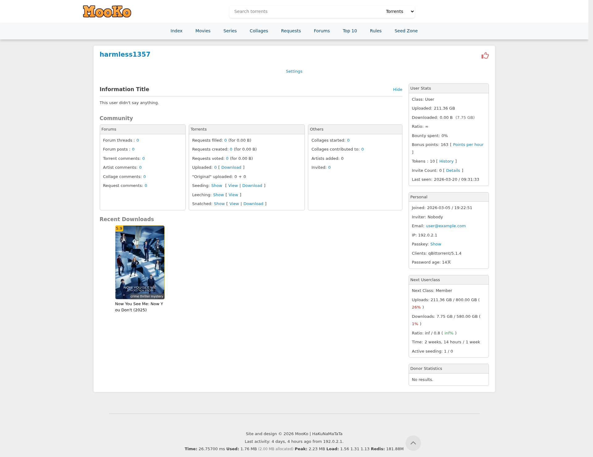

# Tracker Profiles

- [Overview](#overview)
- [Features](#features)
    - [Screenshots](#screenshots)
- [Quick Start](#quick-start)
- [Trackers](#trackers)
    - [Headless](#headless)
    - [Manual Interaction](#manual-interaction)
- [How To Use](#how-to-use)
    - [Web UI](#web-ui)
    - [Importing Trackers](#importing-trackers)
    - [Running With Docker Compose](#running-with-docker-compose)
    - [Browser UI](#browser-ui)
        - [UI In Debian](#ui-in-debian)
        - [UI In Windows](#ui-in-windows)
        - [Disable UI](#disable-ui)
    - [Configuration Options](#configuration-options)
        - [Run Options](#run-options)
        - [Settings](#settings)
        - [Startup-Only Options](#startup-only-options)
        - [JVM Options](#jvm-options)
- [Versioning](#versioning)
- [AI Usage](#ai-usage)
    - [AI Agents](#ai-agents)
    - [Established Patterns](#established-patterns)
    - [Human Review](#human-review)
    - [Exceptions](#exceptions)
        - [JavaScript Redaction](#javascript-redaction)
- [Contributing](#contributing)
    - [Requirements](#requirements)
    - [Install Git Hooks](#install-git-hooks)
    - [Building And Developing In Docker](#building-and-developing-in-docker)
    - [Implementing Support For New Trackers](#implementing-support-for-new-trackers)
    - [Debugging Application](#debugging-application)
    - [Performance Analysis](#performance-analysis)
    - [Cloudflare Verification](#cloudflare-verification)

## Overview

This is a tool used to log in to private torrent websites and take a screenshot of the user's profile page. This can be used to showcase stats on your
current tracker as part of an application to another site. It can also be used as a historical record of your stats on a tracker in case it goes down
or becomes otherwise unavailable.

## Features

- Opens the selected trackers and logs in, navigating to the user's profile page
- Requests user input for trackers with manual inputs (like Captcha, 2FA, etc.)
- Automatically passes Cloudflare verification checks, without any user input
- Redacts the user's sensitive information
    - There are several types of redaction:
        - None (no redaction)
        - Blur (adds a Gaussian blur)
        - Box (draws a solid box)
    - There following elements are currently redacted
        - Email address
        - IP address (including ISP)
        - Passkey (for torrents or for IRC)
- Takes a full-page screenshot of the redacted user profile

### Screenshots

Below are examples of the different types of redaction from the [MooKo](https://mooko.org/) tracker (no longer active).

<details>
<summary>Example Screenshots</summary>
<table>
<tr>
<td valign="top">

#### None



</td>
<td valign="top">

#### Blur


</td>
<td valign="top">

#### Box


</td>
</tr>
</table>
</details>

## Quick Start

This is the fastest way to run the application (no UI configuration required, headless trackers only).

Download the [example compose file](./docs/docker-compose.example.yml) into an empty directory, set a new secret to encrypt the stored
passwords, run only the headless trackers, create the screenshot directory (writable by the container user, UID `1000`), and start the container:

```bash
curl -fsSL -o docker-compose.yml https://raw.githubusercontent.com/zodac/tracker-profiles/master/docs/docker-compose.example.yml
sed -i "s|change-me-strong-secret|$(openssl rand -base64 32)|" docker-compose.yml
sed -i 's/TRACKER_EXECUTION_ORDER: "HEADLESS,MANUAL"/TRACKER_EXECUTION_ORDER: "HEADLESS"/' docker-compose.yml
mkdir -p /tmp/screenshots
docker compose up -d
```

Then open [http://localhost:8080](http://localhost:8080), enter credentials for one or more [headless trackers](#headless) on the **Trackers** tab,
and press **Start** on the **Main** tab. See [Web UI](#web-ui) for more details.

Screenshots are saved to `/tmp/screenshots/<date>/` on your host. See [Configuration Options](#configuration-options) for the full list of settings.

To add many trackers at once, copy [trackers_example.csv](./trackers_example.csv), fill in your credentials, and upload it with **Import CSV** on the
**Trackers** tab (see [Importing Trackers](#importing-trackers)).

## Trackers

There are currently **147** supported trackers listed below. The available trackers come in the following types:

- Headless: Can run with the browser in headless mode, meaning no UI browser is needed
- Manual: There is some user interaction needed (a Captcha or 2FA to log in, etc.), requiring a UI browser

The implementation for these trackers can be found in the [handler](./tracker-profiles-screenshots/src/main/java/net/zodac/tracker/handler) package.

### Headless

The following trackers do not require a UI (unless `FORCE_UI_BROWSER` has been set to **true**), and can be run in the background:

<table>
<tr>
<td valign="top">

| Tracker Name (A–E)                                |
|---------------------------------------------------|
| [720pier](https://720pier.ru/)                    |
| [ABTorrents](https://usefultrash.net/)            |
| [AcrossTheTasman](https://acrossthetasman.com/)   |
| [Aidoru!Online](https://aidoru-online.me/)        |
| [Aither](https://aither.cc/)                      |
| [Alexandria](https://alxdria.org/)                |
| [AlphaRatio](https://alpharatio.cc/)              |
| [AnimeBytes](https://animebytes.tv/)              |
| [AnimeZ](https://animez.to/)                      |
| [ArabicSource](https://arabicsource.net/)         |
| [ArabP2P](https://www.arabp2p.net/)               |
| [AsianCinema](https://eiga.moi/)                  |
| [AussieRul.es](https://aussierul.es/)             |
| [BackUps](https://back-ups.me/)                   |
| [BakaBT](https://bakabt.me/)                      |
| [bitGAMER](https://bitgamer.ch/)                  |
| [BitPorn](https://bitporn.eu/)                    |
| [BlueTorrents](https://bluetorrents.com/)         |
| [Blutopia](https://blutopia.cc/)                  |
| [BootyTape](https://ssl.bootytape.com/)           |
| [BroadcasThe.Net](https://broadcasthe.net/)       |
| [BrokenStones](https://brokenstones.is/)          |
| [BwTorrents](https://bwtorrents.tv/)              |
| [C411](https://c411.org/)                         |
| [CanalStreet](https://canal-street.org/)          |
| [CapybaraBR](https://capybarabr.com/)             |
| [Cathode-Ray.Tube](https://www.cathode-ray.tube/) |
| [Concertos](https://concertos.live/)              |
| [CZTeam](https://czteam.me/)                      |
| [D3Si.NET](https://d3si.net/)                     |
| [DarkPeers](https://darkpeers.org/)               |
| [DesiTorrents](https://desitorrents.tv/)          |
| [DICMusic](https://dicmusic.com/)                 |
| [DimeADozen](http://www.dimeadozen.org/)          |
| [DocsPedia](https://docspedia.world/)             |
| [Empornium](https://www.empornium.sx/)            |
| [eMuwarez](https://emuwarez.com/)                 |
| [ExtremeBits](https://extremebits.net/)           |

</td>
<td valign="top">

| Tracker Name (F–J)                              |
|-------------------------------------------------|
| [F1Carreras](https://f1carreras.xyz/)           |
| [Fappaizuri](https://fappaizuri.me/)            |
| [FileList](https://filelist.io/)                |
| [FunFile](https://www.funfile.org/)             |
| [FunZone](https://myfunzone.org/)               |
| [GreatPosterWall](https://greatposterwall.com/) |
| [HappyFappy](https://www.happyfappy.net/)       |
| [HDUnited](https://hd-united.vn/)               |
| [HDZero](https://hdzero.org/)                   |
| [Hellenic-HD](https://hellenic-hd.cc/)          |
| [Immortal-S](https://immortal-s.me/)            |
| [ImmortalSeed](https://immortalseed.me/)        |
| [InfinityHD](https://infinityhd.net/)           |
| [IPTorrents](https://iptorrents.com/)           |
| [ItaTorrents](https://itatorrents.xyz/)         |
| [JPopsuki](https://jpopsuki.eu/)                |

</td>
<td valign="top">

| Tracker Name (K–O)                             |
|------------------------------------------------|
| [Kufirc](https://kufirc.com/)                  |
| [LastFiles](https://last-torrents.org/)        |
| [Lat-Team](https://lat-team.com/)              |
| [LDU](https://theldu.to/)                      |
| [Libble](https://libble.me/)                   |
| [Linuxtracker](https://linuxtracker.org/)      |
| [Luminarr](https://luminarr.me/)               |
| [MalayaBits](https://malayabits.cc/)           |
| [Metal-Tracker](https://en.metal-tracker.com/) |
| [MidnightScene](https://midnightscene.cc/)     |
| [Milkie](https://milkie.cc/)                   |
| [Milnueve](https://milnueve.cc/)               |
| [Nebulance](https://nebulance.io/)             |
| [Nexum-Core](https://nexum-core.com/)          |
| [NordicBytes](https://nordicbytes.org/)        |
| [NordicQuality](https://nordicq.org/)          |
| [OldToons.World](https://oldtoons.world/)      |
| [OnlyEncodes](https://onlyencodes.cc/)         |
| [Orpheus](https://orpheus.network/)            |

</td>
<td valign="top">

| Tracker Name (P–T)                                   |
|------------------------------------------------------|
| [P2PBG](https://www.p2pbg.com/)                      |
| [PixelCove](https://www.pixelcove.me/)               |
| [PixelHD](https://pixelhd.me/)                       |
| [Podzemlje](https://podzemlje.net/)                  |
| [PolishTorrent](https://polishtorrent.top/)          |
| [Portugas](https://portugas.org/)                    |
| [PussyTorrents](https://pussytorrents.org/)          |
| [Racing4Everyone](https://racing4everyone.eu/)       |
| [Rastastugan](https://rastastugan.org/)              |
| [Redacted](https://redacted.sh/)                     |
| [ReelFlix](https://reelflix.cc/)                     |
| [RetroMoviesClub](https://retro-movies.club/)        |
| [RocketHD](https://rocket-hd.cc/)                    |
| [RUTracker](https://rutracker.org/forum/tracker.php) |
| [SceneHD](https://scenehd.org/)                      |
| [SceneTime](https://www.scenetime.com/)              |
| [SecretCinema](https://secret-cinema.pw/)            |
| [SeedCore](https://seedcore.net/)                    |
| [SeedPool](https://seedpool.org/)                    |
| [SexTorrent](https://sextorrent.myds.me/)            |
| [Shadowbit](https://shadowbit.cc/)                   |
| [Shazbat](https://www.shazbat.tube/)                 |
| [Speed.CD](https://speed.cd/)                        |
| [SpeedApp](https://speedapp.io/)                     |
| [SportsCult](https://sportscult.org/)                |
| [T3nnis](https://t3nnis.tv/)                         |
| [Tasmanit.es](https://tasmanit.es/)                  |
| [TeamOS](https://teamos.xyz/)                        |
| [TheMixingBowl](https://themixingbowl.org/)          |
| [TorrentDay](https://www.torrentday.com/)            |
| [Torrenteros](https://torrenteros.org/)              |
| [Torrenting](https://torrenting.com/)                |
| [TorrentLeech](https://www.torrentleech.org/)        |
| [Tr4ker](https://tr4ker.net/)                        |
| [TVChaosUK](https://tvchaosuk.com/)                  |

</td>
<td valign="top">

| Tracker Name (U–Z)                              |
|-------------------------------------------------|
| [Ultrabits](https://ultrabits.org/)             |
| [Unwalled](https://unwalled.cc/)                |
| [UploadCX](https://upload.cx/)                  |
| [VietMediaF](https://tracker.vietmediaf.store/) |
| [XSpeeds](https://www.xspeeds.eu/)              |
| [XWT-Classics](https://xwt-classics.net/)       |
| [YggReborn](https://www.yggreborn.org/)         |
| [YUSCENE](https://yu-scene.net/)                |
| [Zappateers](https://zappateers.com/)           |

</td>
</tr>
</table>

### Manual Interaction

If any of the following trackers are enabled, and **MANUAL** is included in the tracker order, then a browser UI must be available, since they open a
visible browser window for you to complete the step below. Instructions for this in Docker can be seen [below](#browser-ui). The web UI asks you
when to complete each step (see [Web UI](#web-ui)).

<table>
<tr>
<td valign="top">

| Tracker Name                                        | Reason                            |
|-----------------------------------------------------|-----------------------------------|
| [52PT](https://52pt.site/)                          | Captcha                           |
| [Anthelion](https://anthelion.me/)                  | 2FA                               |
| [AsianDVDClub](https://asiandvdclub.org/)           | Question on login                 |
| [AvistaZ](https://avistaz.to/)                      | Captcha                           |
| [Baozi](https://p.t-baozi.cc/)                      | Captcha                           |
| [BeyondHD](https://beyond-hd.me/)                   | Captcha                           |
| [BTArg](https://www.btarg.com.ar/tracker/)          | Needs to be explicitly translated |
| [CGPeers](https://cgpeers.to/)                      | 2FA                               |
| [CinemaZ](https://cinemaz.to/)                      | Captcha                           |
| [DigitalCore.Club](https://digitalcore.club/)       | Captcha                           |
| [ExoticaZ](https://exoticaz.to/)                    | Captcha                           |
| [GazelleGames](https://gazellegames.net/)           | Question on login                 |
| [Hawke-Uno](https://hawke.uno/)                     | 2FA                               |
| [HDBits](https://hdbits.org/)                       | 2FA & question on login           |
| [Leech24](https://leech24.net/)                     | Captcha                           |
| [LetSeed](https://letseed.org/)                     | Captcha                           |
| [LP-Bits](https://lp-bits.com/)                     | Captcha                           |
| [LST](https://lst.gg/)                              | Question on login                 |
| [PassThePopcorn](https://passthepopcorn.me/)        | Question on login                 |
| [PornoLab](https://pornolab.net/forum/tracker.php)  | Needs to be explicitly translated |
| [PrivateHD](https://privatehd.to/)                  | Captcha                           |
| [SkyeySnow](https://skyeysnow.com/)                 | Needs to be explicitly translated |
| [SocietyGlitch](https://stalker.societyglitch.com/) | Captcha                           |
| [TheEmpire](https://theempire.click/)               | Captcha                           |
| [TheGeeks](https://thegeeks.click/)                 | Captcha                           |
| [TheKitchen](https://thekitchen.click/)             | Captcha                           |
| [TheOccult](https://theoccult.click/)               | Captcha                           |
| [ThePlace](https://theplace.click/)                 | Captcha                           |
| [TheShow](https://theshow.click/)                   | Captcha                           |
| [TheVault](https://thevault.click/)                 | Captcha                           |

</td>
</tr>
</table>

### Unsupported

The following trackers are explicitly not supported, either due to limitations with accessing them, or due to their terms and conditions forbidding
this type of automated access.

<table>
<tr>
<td valign="top">

| Tracker Name                                  | Reason                                    |
|-----------------------------------------------|-------------------------------------------|
| [MyAnonaMouse](https://www.myanonamouse.net/) | Non-API access is not approved (Rule 1.7) |

</td>
</tr>
</table>

## How To Use

### Web UI

The application is used through a web UI on port `8080` (configurable with `WEB_UI_PORT`), which has three tabs:

- **Main**: start an execution and follow its progress
    - **Start** executes every enabled tracker. Once an execution has ended with failed trackers, **Failures only** executes just those trackers
      again (any that have since been disabled are left out). The run options and settings can be changed between executions
    - Every tracker in the execution is listed, grouped as in progress, waiting, failed or succeeded. A tracker moves between groups as the execution
      continues, so once it finishes the trackers are grouped by whether they succeeded or failed
    - Each tracker shows which step it is on (opening the tracker, logging in, opening the profile page, taking the screenshots, logging out), its
      latest message (for a failed tracker, why it failed) and how long it took. Expand a tracker to see its own logs, which update while it runs.
      The logs are grouped by step, each showing whether it is done, running, failed or not run, how long it took and how many messages (and
      warnings) it has. The step in progress, or the step that failed, is opened automatically. If a tracker is retried, the messages of each
      attempt are separated within each step, and the screenshot messages are separated by redaction type
    - An expanded tracker also shows thumbnails of its screenshots: one per redaction type once it succeeds, or its failure screenshot if it failed
      (with `TAKE_SCREENSHOT_ON_ERROR` enabled). Select a thumbnail to view the screenshot (scaled to 1080p, with a link to open it at full size),
      and move between the redaction types with the arrows (or the arrow keys)
    - Each screenshot can be downloaded on its own, as can every screenshot of a tracker. **Download all** downloads the latest screenshots of
      every tracker that has succeeded in any execution (also before a restart): a tracker executed again only has the screenshots of its
      latest success, so after **Failures only** the trackers that succeeded in either execution are downloaded together. Screenshots deleted or
      moved since are left out, and the button is hidden when none are left. Several screenshots are
      downloaded as a `.zip` file named `tracker-profiles_v<version>_<date>.zip`, where the date is when the latest execution started
      (`yyyy-MM-dd_HH:mm:ss`, in `TIMEZONE`). The thumbnails only show the current (or most recent) execution, which is kept in memory until the
      application restarts (the screenshots are still saved to the output directory as before)
    - Messages not logged by a tracker, such as the summary of the execution, are under **Execution log**
    - **Run options** (open until an execution is started) holds the [options](#configuration-options) you are most likely to change for an execution,
      such as the tracker order, the number of attempts per tracker or the log level. Run options and settings are locked while an execution is in
      progress
    - A running execution can be cancelled, which closes all browsers and stops immediately (trackers already screenshot are kept), without stopping
      the container
- **Trackers**: every supported tracker, grouped by enabled/disabled (enabled trackers are further grouped into headless/manual), with trackers
  that have no username or password listed as unset. Each has fields for the username/email and password, and the result of its most recent
  execution. A tracker whose credentials have just been set (or removed) stays where it is until you click elsewhere (or make no change for 10
  seconds), then moves to its new group. A saved password is shown as dots, and deleting them removes the password (and disables the tracker).
  The image button next to a tracker's last result expands its row to show thumbnails of the screenshots of its latest successful execution
  (from any execution, also before a restart), as long as they are still on disk. Several trackers can be selected with `Ctrl`+click (or
  `Ctrl`+`Shift`+click for a range) to enable, disable or remove them together. Trackers can also be [imported from a CSV file](#importing-trackers)
- **Settings**: the remaining [configuration options](#configuration-options), preloaded from the environment variables. Any value that differs
  from its default is marked with a bar, and a value saved in the web UI is marked as *Saved*

Changes are saved automatically (text fields once you stop typing), with a pop-up confirming each save. The UI follows your operating system's
light/dark mode, which can be overridden with the button in the header (the choice is remembered by your browser).

Tracker credentials, settings saved in the web UI, the result of each tracker's most recent execution and the location of the screenshots of its
latest successful execution are stored in a SQLite database
(`DATABASE_PATH`), in the `/app/data` volume of the container. This is separate from the screenshots, so it can be mounted, backed up or cleared on
its own. The [example compose file](./docs/docker-compose.example.yml) uses the named volume `tracker-profiles-data`:

- The data is kept when the container is recreated (`docker compose down` and `docker compose up`), as the named volume is reused
- To start again with no trackers or saved settings, remove the volume as well: `docker compose down --volumes` (or
  `docker volume rm tracker-profiles-data`)
- To keep the database on the host instead, bind-mount a directory in place of the named volume: `/tmp/tracker-profiles-data:/app/data` (it must be
  writable by the container user, UID `1000` by default)

If no volume is mounted, Docker creates an anonymous volume, which is not reused when a new container is created.

Settings saved in the web UI take precedence over environment variables (including after a restart). See
[Configuration Options](#configuration-options) for when a change to each option takes effect, and which can only be set as environment variables.

Tracker passwords are encrypted in the database (AES-256-GCM), with a key derived from the `SECRET_KEY` environment variable, which must be set to
at least 16 characters (for example, the output of `openssl rand -base64 32`). Keep the same secret for as long as the database is used: if it
changes, the stored passwords cannot be decrypted and the application does not start. Passwords saved by an earlier version in plain text are
encrypted when the application starts.

> **Note:** The web UI has no authentication. Do not expose the port outside your local network. Saved passwords are never sent back to the
> browser.

When a [manual tracker](#manual-interaction) needs you to solve a captcha, enter a 2FA code or similar, a prompt appears at the top of the **Main**
tab (and the tab title changes). Complete the step in the tracker's browser window, then select **Continue**; the execution also continues by itself
if the page in the browser changes. **Skip tracker** fails the current attempt for that tracker. If `INPUT_TIMEOUT_SECONDS` is set, the prompt shows
how long is left, and **+5 min** gives you more time. The browser window itself still needs a display, so `DISPLAY` must be configured to execute
manual trackers (see [Browser UI](#browser-ui)).

### Importing Trackers

Credentials for many trackers can be added at once with **Import CSV** on the **Trackers** tab. Copy the
[trackers_example.csv](trackers_example.csv) file and update it with your login information for each tracker. Any unwanted trackers can be deleted,
or prefixed with `#` so they are ignored. The tracker names are case-insensitive.

Each imported tracker is enabled, and replaces any credentials already saved for it. Trackers in the file that are not supported are listed after
the import, and are not saved.

### Running With Docker Compose

The application is run with Docker Compose. Download [docker-compose.example.yml](./docs/docker-compose.example.yml) as `docker-compose.yml` into an
empty directory, and update it:

- Set `SECRET_KEY` (marked with a `TODO`) to a new secret, for example the output of `openssl rand -base64 32`, and keep the same value for as long
  as the same database is used
- Update the [configuration options](#configuration-options) as needed, which are grouped by what they configure (most can also be changed later in
  the [web UI](#web-ui))
- Create the screenshot directory (`/tmp/screenshots` by default), which must be writable by the container user (UID `1000`)

Then start the application with `docker compose up -d`. The web UI is available at [http://localhost:8080](http://localhost:8080), the
application logs are shown with `docker compose logs -f`, and the application is stopped with `docker compose down`.

The example uses a fixed image version (the latest release), so update the `image` tag to upgrade. It also restricts the container:

- The web UI is only reachable from the host itself (`127.0.0.1:8080:8080`), since it has no authentication. To reach it from other devices on your
  local network, change it to `8080:8080`
- The container runs as a non-root user with no Linux capabilities, a read-only root filesystem (with `/tmp` in memory, and the data in volumes),
  and limits on memory and processes. The limits suit the default of 5 parallel browsers, so raise them if `NUMBER_OF_PARALLEL_THREADS` or
  `BROWSER_RESOLUTION` is increased

The example runs the browser with a UI on a Debian host (see [Browser UI](#browser-ui)). On Windows, set `DISPLAY` to `host.docker.internal:0`,
remove the `/tmp/.X11-unix` volume, and save the screenshots to a Windows path (such as `C:/tmp/screenshots:/app/screenshots`).

### Browser UI

There are two ways to execute the application - with a UI browser and without. The [example compose file](./docs/docker-compose.example.yml) will
execute [trackers that require a UI](#manual-interaction), so the UI will need to be configured to run through Docker. A UI browser is needed for
trackers that require some user input during login, like a Captcha, 2FA, etc.

Below will define how to do this for your host system.

#### UI in Debian

To run through Docker with a UI, local connections to the host display might need to be enabled:

```bash
# This seems to be reset upon reboot and may need to be reapplied
xhost +local:
```

#### UI in Windows

I use [VcXsrv](https://vcxsrv.com/) as the X server for UI. When configuring VcXsrv, make sure to set the following in
the configuration:

- **Multiple windows**
- Display number **-1** or **0**
- **Disable access control**

#### Disable UI

To disable the UI and run the browser in headless mode only, ensure `FORCE_UI_BROWSER` and `ENABLE_TRANSLATION_TO_ENGLISH` are set to **false**, and
exclude **MANUAL** from `TRACKER_EXECUTION_ORDER`. `DISPLAY` and the `/tmp/.X11-unix` volume can then be removed from the compose file.

### Configuration Options

All options are set with environment variables on the docker image, and most can also be changed in the [web UI](#web-ui). They fall into three
groups:

- [Run Options](#run-options) are shown on the **Main** tab, next to the controls to start an execution
- [Settings](#settings) are shown on the **Settings** tab
- [Startup-Only Options](#startup-only-options) can only be set as environment variables, and need the container to be restarted to change

A value changed in the web UI is saved to the database (`DATABASE_PATH`), and from then on overrides the environment variable, including after the
container is restarted. Run options and settings cannot be changed while an execution is in progress.

#### Run Options

These options apply from the next execution.

| Environment Variable            | Description                                                                                                                                                         | Default Value   |
|---------------------------------|---------------------------------------------------------------------------------------------------------------------------------------------------------------------|-----------------|
| *ENABLE_ADULT_TRACKERS*         | Whether to take screenshots of trackers that primarily host adult content                                                                                           | true            |
| *FORCE_UI_BROWSER*              | Forces a browser with UI for each tracker, even for headless trackers (this will disable parallel execution)                                                        | false           |
| *INPUT_TIMEOUT_SECONDS*         | How long to wait for a user input for a [manual tracker](#manual-interaction), in seconds, before the attempt fails (0 waits until the user responds)               | 0               |
| *LOG_LEVEL*                     | The logging level for application output [ALL, TRACE, DEBUG, INFO, WARN, ERROR, FATAL, OFF](https://logging.apache.org/log4j/2.x/manual/customloglevels.html)       | INFO            |
| *NUMBER_OF_PARALLEL_THREADS*    | The number of parallel browser threads to use for Headless trackers [min: 1, max: 32]                                                                               | 5               |
| *NUMBER_OF_SCREENSHOT_ATTEMPTS* | The number of times to attempt to screenshot a tracker before marking it as a fail [min: 1, max: 5]                                                                 | 1               |
| *TAKE_SCREENSHOT_ON_ERROR*      | Whether to take a screenshot of the current tracker page if any failure occurs (in a subdirectory called `errors`)                                                  | false           |
| *TRACKER_EXECUTION_ORDER*       | The order in which different tracker types should be executed, at least one must be selected (case-insensitive)                                                     | HEADLESS,MANUAL |

#### Settings

Changes to these options apply from the next execution.

| Environment Variable            | Description                                                                                                                                                                                                                                     | Default Value    |
|---------------------------------|-------------------------------------------------------------------------------------------------------------------------------------------------------------------------------------------------------------------------------------------------|------------------|
| *BROWSER_RESOLUTION*            | The resolution (`widthxheight`, in pixels) of the web browser used to take screenshots [1280x1024, 1600x1000, 1600x1200, 1680x1050, 1920x1080, 1920x1200, 2560x1440, 7680x4320]                                                                 | 1680x1050        |
| *ENABLE_TRANSLATION_TO_ENGLISH* | Whether to translate non-English trackers to English                                                                                                                                                                                            | true             |
| *OUTPUT_DIRECTORY_NAME_FORMAT*  | The name of the output directory to be created for the of the screenshots (see [Patterns for Formatting and Parsing](https://docs.oracle.com/javase/8/docs/api/java/time/format/DateTimeFormatter.html))                                        | yyyy-MM-dd       |
| *OUTPUT_DIRECTORY_PARENT_PATH*  | The output location of the new directory created for the screenshots                                                                                                                                                                            | /app/screenshots |
| *REDACTION_TYPE*                | Comma-separated list of redaction types to apply (if more than one is selected then multiple screenshots will be taken) [BLUR, BOX, NONE](./tracker-profiles-screenshots/src/main/java/net/zodac/tracker/framework/redactor/RedactionType.java) | BOX              |
| *SCREENSHOT_EXISTS_ACTION*      | What to do when a screenshot for the tracker for the given date already exists [CREATE_ANOTHER, OVERWRITE, SKIP](./tracker-profiles-screenshots/src/main/java/net/zodac/tracker/framework/config/ExistingScreenshotAction.java)                 | CREATE_ANOTHER   |
| *TIMEZONE*                      | The local timezone, used for the date in the names of the output directory and of downloaded screenshots                                                                                                                                        | UTC              |

#### Startup-Only Options

These options are read once when the container starts. The application options are shown on the **Settings** tab of the web UI for reference
(marked as *Environment only*, with the value of `SECRET_KEY` hidden), but cannot be changed there. `DISPLAY`, `JAVA_OPTS` and
`JAVA_ADDITIONAL_OPTS` configure the container itself, so are not shown in the web UI.

| Environment Variable   | Description                                                                                                                                                     | Default Value                 |
|------------------------|-----------------------------------------------------------------------------------------------------------------------------------------------------------------|-------------------------------|
| *DATABASE_PATH*        | The path to the SQLite database storing tracker credentials, settings saved in the [web UI](#web-ui) and tracker results (inside the `/app/data` docker volume) | /app/data/tracker-profiles.db |
| *DISPLAY*              | The X11 display used to render browser screenshots (see [Browser UI](#browser-ui))                                                                              |                               |
| *JAVA_ADDITIONAL_OPTS* | Additional JVM options to be appended to [start.sh](./docker/scripts/start.sh)                                                                                  |                               |
| *JAVA_OPTS*            | Replaces all default JVM options entirely; if unset or empty, the built-in defaults are used (see [JVM Options](#jvm-options))                                  |                               |
| *SECRET_KEY*           | **Required.** The secret used to encrypt the tracker passwords stored in the database, at least 16 characters (never shown in the web UI)                       |                               |
| *WEB_UI_PORT*          | The port on which the [web UI](#web-ui) is served [min: 1, max: 65535]                                                                                          | 8080                          |

#### JVM Options

The following options are passed to the Java process by default:

```text
-Xms128m -Xmx512m
-XX:+UnlockExperimentalVMOptions -XX:+UseCompactObjectHeaders
-XX:+UseG1GC -XX:ParallelGCThreads=4 -XX:ConcGCThreads=2 -XX:MaxGCPauseMillis=200
-XX:SharedArchiveFile=/app/app.jsa -Xshare:auto
-Djava.util.logging.config.file=/app/logging.properties
```

Set `JAVA_OPTS` to replace all defaults entirely (e.g., to swap the GC algorithm or remove experimental flags). Set `JAVA_ADDITIONAL_OPTS` to append
extra flags on top of whichever options are active, which can be useful for enabling JFR recording, GC logging, or similar diagnostics.

## Versioning

This project follows [Semantic Versioning](https://semver.org/) (`MAJOR.MINOR.PATCH`):

- **MAJOR**: incompatible changes to the public API (e.g. removed or renamed configuration options, changed CSV format)
- **MINOR**: backwards-compatible new functionality added to the public API (e.g. new configuration options or trackers)
- **PATCH**: backwards-compatible bug fixes or code changes

Changes to the [trackers_example.csv](./trackers_example.csv) file are considered `MINOR` (new trackers) or `MAJOR` (updates to the tracker
name, or removal of support).

However, removing a tracker due to the site no longer being available is **not** considered a `MAJOR` change. Trackers are external to the
application and not part of its public API, as their availability depends on third-party sites that can change or disappear at any time. Tracker
removals will be released as `PATCH` versions.

## AI Usage

I use AI agents to perform the "first-pass" implementation for a new tracker site. The AI will investigate and evaluate the generate structure of the
site and build an initial handler. Based off of this, I'll refine and test until I'm happy that it matches the same standards as the existing
implementations.

Since there were over 100 implementations prior to using AI, there are established patterns and styles to follow, hopefully guiding the AI to follow
the same standards.

### AI Agents

[Claude Code](https://claude.com/claude-code) employs a multi-agent pipeline to implement each new tracker handler:

| Agent                    | Responsibility                                                                                                                                                             |
|--------------------------|----------------------------------------------------------------------------------------------------------------------------------------------------------------------------|
| **Orchestrator**         | Coordinates the full workflow, delegating to specialised sub-agents in sequence                                                                                            |
| **Login Agent**          | Inspects the tracker's login page to determine the correct selectors for the username field, password field, login button, and post-login confirmation element             |
| **Profile Agent**        | Navigates the user's profile page to identify the navigation selector that reaches it, the content selector that confirms it has loaded, and the logout button selector    |
| **Page Structure Agent** | Invoked when the profile agent flags structural elements and  detects cookie/consent banners, fixed headers, and fixed sidebars that must be handled before screenshotting |
| **Redactor Agent**       | Reviews the profile page for sensitive fields and determines the appropriate redaction selectors                                                                           |

### Established Patterns

Every implementation relies on:

- **Existing handler code**: The agents study the handlers already in
  the [handler/](./tracker-profiles-screenshots/src/main/java/net/zodac/tracker/handler) package to understand project conventions, selector
  construction patterns, and platform-specific base classes (`Unit3dHandler`, `GazelleHandler`, etc.)
- **[CLAUDE.md](./.claude/CLAUDE.md)**: This defines project-level standards covering structure, selector conventions, linting rules, and the
  mandatory post-implementation checklist
- **Agent definitions**: Each agent has a [Markdown](.claude/agents) file defining its scope, and how to parse the tracker to build the handler, which
  is refined over time

### Human Review

All AI-generated code is reviewed and approved before being merged, including manual testing of the new handler. Since each handler needs to be tested
against a real site, there's no value to automating much testing, so each implementation will be verified manually.

### Exceptions

#### JavaScript Redaction

The [JavaScript redaction logic](./tracker-profiles-screenshots/src/main/resources/net/zodac/tracker/framework/redactor) used
in [JavaScriptRedactor](./tracker-profiles-screenshots/src/main/java/net/zodac/tracker/framework/redactor/JavaScriptRedactor.java) is mostly AI
created with little input from me. I don't know JavaScript well enough to perform this overlay-based redaction, but I verify against all tracker
handlers when updates are made, to cover as many cases as possible.

## Contributing

### Requirements

- [Docker](https://docs.docker.com/engine/install/)
- [Java](https://jdk.java.net/)

### Install Git Hooks

Run the following command to run git hooks for the project:

```bash
bash ./.hooks/setup-hooks.sh
```

### Building And Developing In Docker

To build and run the local [Dockerfile](./docker/Dockerfile), copy [docker-compose.example.yml](./docs/docker-compose.example.yml) to
`docker-compose.yml` in the root of the repository (it is ignored by git), and replace `image: zodac/tracker-profiles:<version>` with:

```yaml
    build:
      context: .
      dockerfile: docker/Dockerfile
    image: tracker-profiles-dev
```

Then update the [configuration options](#configuration-options) for development (such as `FORCE_UI_BROWSER=true`, `LOG_LEVEL=TRACE`,
`REDACTION_TYPE=NONE,BLUR,BOX` and `TAKE_SCREENSHOT_ON_ERROR=true`, which requires [the UI to be defined](#browser-ui)), and build and run it:

```bash
docker compose up --build
```

### Implementing Support For New Trackers

All supported private trackers have an implementation found in
the [handler](./tracker-profiles-screenshots/src/main/java/net/zodac/tracker/handler) package. To add a new one, extend
[AbstractTrackerHandler.java](./tracker-profiles-screenshots/src/main/java/net/zodac/tracker/handler/AbstractTrackerHandler.java),
following the convention from an existing implementation
like [AbTorrents.java](./tracker-profiles-screenshots/src/main/java/net/zodac/tracker/handler/AbTorrents.java).

Ensure the [TrackerType](./tracker-profiles-screenshots/src/main/java/net/zodac/tracker/framework/TrackerType.java) is
set correctly for your tracker.

### Debugging Application

Rather than using debugging tools, I generally add log statements (and then tune the log level once finished debugging). But if needed, you can also
use IDE debugging tools in IntelliJ as follows. Click on **Run**> **Edit Configurations** and add the environment variables for the application.
Once done, open the [ApplicationLauncher.java](./tracker-profiles-screenshots/src/main/java/net/zodac/tracker/ApplicationLauncher.java) and run the
`main` method from the IDE.
The [AbstractTrackerHandler.java](./tracker-profiles-screenshots/src/main/java/net/zodac/tracker/handler/AbstractTrackerHandler.java) implementation
for each tracker is retrieved by the tracker name saved in the web UI.

[Selenium WebDriver](https://www.selenium.dev/documentation/webdriver/) is used to leverage the Chromium web browser to
take screenshots. While the application usually runs in headless mode, this can be changed by updating the
`FORCE_UI_BROWSER` value in the [configuration](#configuration-options). This will cause a new browser instance to
launch when taking a screenshot, and can be used for debugging a new implementation.

### Performance Analysis

To generate a `.jfr` file for profiling with [Java Mission Control (JMC)](https://jdk.java.net/jmc/), build and run the JAR with JFR flags
(environment variables are prefixed before `java`, equivalent to `environment` in the [compose file](./docs/docker-compose.example.yml)), then start an
execution from the [web UI](#web-ui) at [http://localhost:8080](http://localhost:8080):

```bash
mvn clean install && \
    BROWSER_RESOLUTION=1680x1050 \
    ENABLE_ADULT_TRACKERS=true \
    ENABLE_TRANSLATION_TO_ENGLISH=true \
    FORCE_UI_BROWSER=true \
    INPUT_TIMEOUT_SECONDS=300 \
    LOG_LEVEL=TRACE \
    NUMBER_OF_PARALLEL_THREADS=5 \
    NUMBER_OF_SCREENSHOT_ATTEMPTS=5 \
    OUTPUT_DIRECTORY_NAME_FORMAT=yyyy-MM-dd \
    OUTPUT_DIRECTORY_PARENT_PATH=/tmp/screenshots \
    REDACTION_TYPE=NONE,BLUR,BOX \
    SCREENSHOT_EXISTS_ACTION=CREATE_ANOTHER \
    TAKE_SCREENSHOT_ON_ERROR=true \
    TIMEZONE=UTC \
    TRACKER_EXECUTION_ORDER=HEADLESS,MANUAL \
    java \
        --enable-preview \
        -Xms128m -Xmx512m \
        -XX:+UseG1GC -XX:ParallelGCThreads=4 -XX:ConcGCThreads=2 -XX:MaxGCPauseMillis=200 \
        -XX:StartFlightRecording=filename=recording_$(date +%Y%m%d_%H%M%S).jfr,settings=profile,dumponexit=true \
        -jar ./tracker-profiles-screenshots/target/tracker-profiles-screenshots-*.jar
```

Once the execution completes, stop the application (`Ctrl+C`), then open the generated `.jfr` file in Java Mission Control to analyse CPU usage,
memory allocation, GC activity, and thread behaviour.

### Cloudflare Verification

Some trackers have a Cloudflare verification check that must be passed before logging in, either as a full-page challenge or as a box in the login
form. This check is passed automatically without any user input, including when the browser is running in headless mode.

No additional library is used for this. The approach is based on the one used by [zendriver](https://github.com/cdpdriver/zendriver), implemented
directly on top of the existing Selenium browser:

- The headless browser does not identify itself as headless in its user agent
- The check is found using the [Chrome DevTools Protocol](https://chromedevtools.github.io/devtools-protocol/) instead of JavaScript running in
  the web page, as Cloudflare can detect the latter
- The checkbox is clicked with a browser-level mouse event through the Chrome DevTools Protocol, which works without a visible browser window
- The checkbox is only clicked if the check asks for it, as some websites pass the check without any interaction
- The variables that `chromedriver` adds to every web page (which websites use to detect an automated browser) are removed from the
  `chromedriver` binary when the Docker image is built

If Cloudflare rejects the attempt, no further clicks are made and the error code reported by Cloudflare is logged. If the check cannot be passed
automatically:

- For a tracker running in a headless browser, the attempt fails (and is retried if `NUMBER_OF_SCREENSHOT_ATTEMPTS` allows)
- For a tracker running in a UI browser (a `Manual` tracker, or when `FORCE_UI_BROWSER` is **true**), the user is asked to pass the check instead
